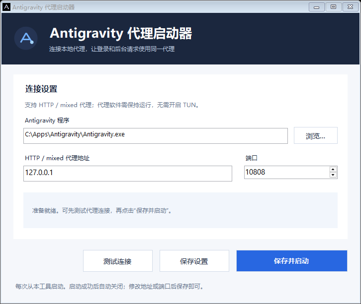

# Antigravity 代理启动器

一个轻量的 Windows 工具，为 Antigravity 及其子进程设置代理环境变量。打开工具，点击“保存并启动”，成功后启动器自动退出。

A lightweight Windows launcher that starts Antigravity with per-process proxy environment variables, then exits.

[下载最新版本](https://github.com/etcboy/antigravity-proxy-launcher/releases/latest) · [使用说明](docs/usage.md) · [MIT 许可证](LICENSE)



## 功能

- 支持提供 **HTTP / mixed 代理端口**的软件，不绑定特定代理客户端。
- 可测试连接、修改和保存程序位置、代理地址及端口。
- 成功保存并启动 Antigravity 后自动退出，无需驻留后台。
- 设置保存在当前用户 AppData，exe 旁边不生成配置文件。
- 启动失败时保留窗口显示原因。
- 使用简单窗口，不创建桌面图标或开始菜单入口。

## 快速开始

适用于 Windows 10 / 11，需要 .NET Framework 4.8 和已安装的 Antigravity。

1. 从 [Releases](https://github.com/etcboy/antigravity-proxy-launcher/releases/latest) 下载 `Antigravity-Proxy-Launcher.exe`。
2. 保持代理软件运行，打开本工具，选择 Antigravity 主程序，填写 HTTP / mixed 地址和端口。
3. 可先点击“测试连接”，再点击“保存并启动”。
4. 以后每次都从本工具启动；之前保存的设置会自动填入。

修改代理地址、端口或程序位置时，直接在窗口中修改并保存。如果只更换代理软件，但地址和端口没变，不需要重新设置。

浏览器登录也需要可用的网络连接，例如系统代理。已经运行的 Antigravity 无法通过另一个启动过程更换环境，请先保存工作并完全退出。

> 此工具自身不提供代理节点，也不强制接管程序流量。它依赖当前版本的 Antigravity 遵循 `HTTP_PROXY` / `HTTPS_PROXY` 等环境变量；是否适用于你的版本，应通过实际登录和 AI 对话验证。

## 工作原理

启动子进程时设置 `HTTP_PROXY`、`HTTPS_PROXY`、`ALL_PROXY`，并通过 `NO_PROXY=localhost,127.0.0.1,::1` 排除本机内部连接。

设置保存在 `%LOCALAPPDATA%\AntigravityProxyLauncher\settings.json`。环境变量只传给启动的 Antigravity 及其子进程，不永久修改 Windows 用户或系统环境变量。本工具不读取账号密码或登录令牌。

## 从 v1.3.0 升级

v1.3.1 恢复为简单窗口模式。下载新版 exe 后直接打开，原有设置会继续读取。

v1.3.0 创建的“Antigravity（代理）”桌面图标和“Antigravity 代理设置”开始菜单入口不会自动更新为新版，可以手动删除。以后直接打开新版工具即可。保留 AppData 下的 `settings.json` 可继续使用原配置。

## 从源码构建

在 Windows PowerShell 中运行：

```powershell
.\build.ps1
.\tests\run-tests.ps1
.\package.ps1 -SkipBuild
```

构建使用系统 .NET Framework 的 C# 编译器，无第三方运行时依赖。产物位于 `dist/`，exe 可单独运行。测试使用本地模拟端口和子进程，不需要账号、代理订阅或 Google 连接，不修改真实桌面或开始菜单。

推送 `v*` 标签会通过 GitHub Actions 构建、测试并发布 exe、便携压缩包和 SHA-256 校验文件。

## 限制

- 仅支持无需用户名和密码的 HTTP 代理端口，包括 mixed 端口；不能填写仅支持 SOCKS 的端口。
- 连接测试仅验证网络路径，不验证账号资格、服务地区或 AI 功能。
- 软件未进行商业代码签名。

这是独立开源项目，与 Google 或 Antigravity 官方无关联。